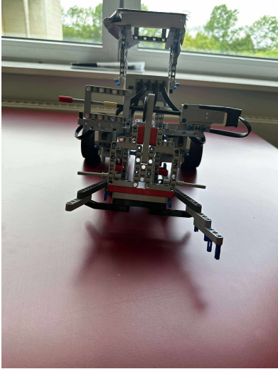
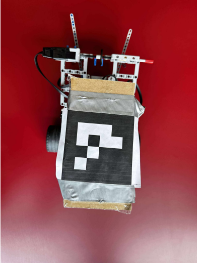
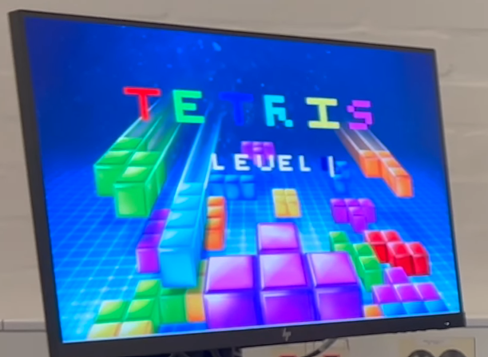
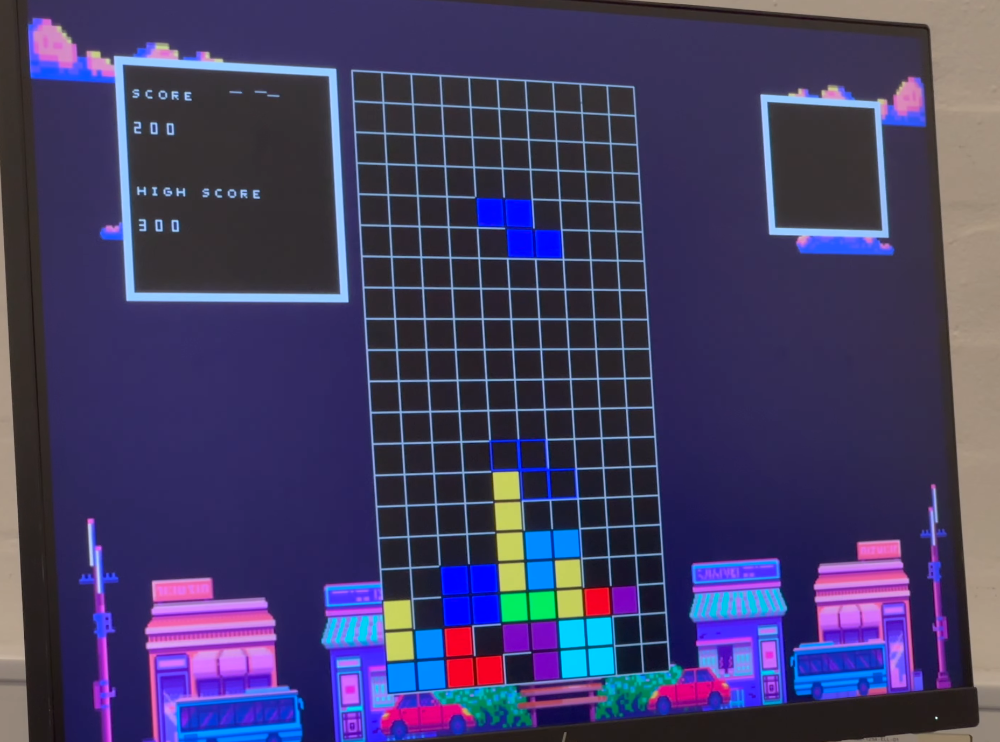

# Benjamin Hadziosmanovic

**Computer Engineering @ DTU · Software Development · AI · FPGA Systems**

I build practical software, explore intelligent systems, and enjoy turning technical problems into working solutions.

---

### About me

I'm a Computer Engineering student at the **Technical University of Denmark (DTU)**, working across software, embedded systems, and digital signal processing.

At **DTU Risø**, I work with **FPGA-based virtual instrumentation and RFSoC signal processing**, combining hardware experiments with Python-based analysis and debugging. Outside the lab, I build **FupTjek**, a Danish scam-awareness web app, and work on hands-on projects in **robotics, computer vision, and FPGA development**.

I'm particularly interested in **software engineering, applied AI, cybersecurity, and embedded development**.

### Selected projects

<table>
<tr>
<td width="50%" valign="top">

**[FupTjek](https://github.com/Hadziosmanovicb/FupTjek)** · [Live website](https://fuptjek.dk)

A Danish web application helping people recognize warning signs in suspicious messages. Built around accessible UX and practical scam detection, with frontend, backend, and testing work.

`React` `TypeScript` `Vite` `Node.js` `OpenAI API`

</td>
<td width="50%" valign="top">

**DTU Risø — FPGA Virtual Instrumentation** · Internship

Working with RFSoC-based spectrum analysis, experimental signal validation, and Python models for signal correction. Includes hands-on debugging against laboratory reference instruments.

`RFSoC` `FPGA` `Python` `Signal processing`

</td>
</tr>
</table>

#### GolfBot — Robotics & Computer Vision

**[DTU CDIO team project](https://github.com/s235070/62410-CDIO-Project)**

A physical robot prototype built during a DTU CDIO project, alongside work involving **YOLOv8 object detection** and robotics. The images below show the actual hardware prototype.

`Python` `YOLOv8` `Computer vision` `Robotics` `Hardware/software integration`

<table>
<tr>
<td width="50%" align="center" valign="middle"></td>
<td width="50%" align="center" valign="middle"></td>
</tr>
</table>

#### Tetris — FPGA / ZYBO

**[Tetris on ZYBO](https://github.com/Hadziosmanovicb/Tetris_ZYBO)**

An FPGA-based Tetris implementation on a ZYBO development board, featuring a custom game display. The photos show the title screen and the game running on a monitor.

`VHDL` `FPGA` `Digital systems`

<table>
<tr>
<td width="40%" align="center" valign="middle"></td>
<td width="60%" align="center" valign="middle"></td>
</tr>
</table>

### Technologies I work with

**Languages**  
    

**Tools & frameworks**  
    

### GitHub activity

### What I'm working on

- Building and improving **[FupTjek](https://fuptjek.dk)**, with an emphasis on clarity, security, and maintainability.
- Exploring **computer vision and robotics** through projects such as [GolfBot](https://github.com/s235070/62410-CDIO-Project).
- Gaining hands-on experience in **RFSoC-based measurement and signal processing** at DTU Risø.

---

**Open to student opportunities in software development, AI, cybersecurity, and embedded systems.**

[View my repositories](https://github.com/Hadziosmanovicb?tab=repositories)

